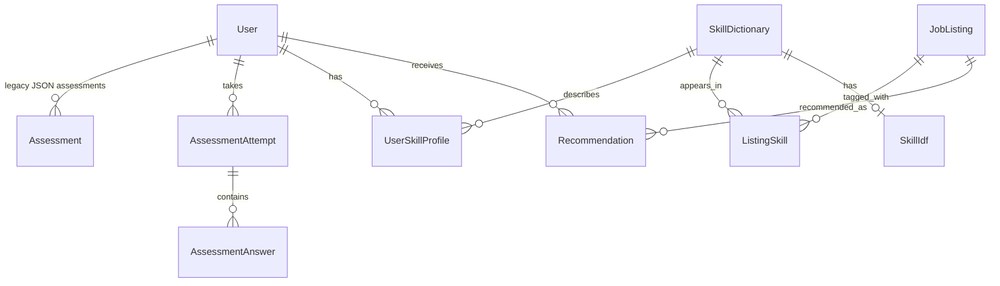

# Database Relationship Summary

The application uses PostgreSQL, with Prisma models defined in `prisma/schema.prisma`.
The diagram below summarizes the relationships declared in that schema.

## Tables and relationships

- **`users`** stores accounts. A user can have multiple assessment attempts,
  skill-profile entries, and recommendations.
- **`assessment_attempt`** stores each submitted assessment for a user.
  **`assessment_answer`** stores that attempt's category/level answers. Its
  composite primary key (`attempt_id`, `category`) allows one answer per
  category per attempt.
- **`user_skill_profile`** joins a user to a skill from **`skills_dictionary`**.
  Its composite primary key (`user_id`, `skill_id`) gives each user one profile
  row per skill. The row tracks assessment weight, resume/certificate evidence,
  and final weight.
- **`skills_dictionary`** stores canonical skills, synonyms, and optional
  assessment categories. It links skills to user profiles and job listings.
- **`job_listings`** stores job and other listing records. **`listing_skill`**
  joins listings to dictionary skills and stores term-count and TF-IDF values.
  Its composite primary key (`listing_id`, `skill_id`) allows one row per skill
  on each listing.
- **`skill_idf`** stores IDF statistics for dictionary skills; `skill_id` is
  both its primary key and foreign key, so each skill has at most one IDF row.
- **`recommendation`** joins a user to a job listing and stores match score,
  readiness, gaps, and computation time. Its composite primary key
  (`user_id`, `listing_id`) allows one current row per user/listing pair.
- **`assessments`** is an older model that stores answers together as JSON.
  The current assessment routes use `assessment_attempt` and
  `assessment_answer` instead.
- **`profile`** stores profile/resume fields, but the Prisma schema does not
  declare a relation or foreign key from it to `users`; `user_id` is nullable.

## Delete behavior

Deleting a user cascades to their assessment attempts, skill-profile entries,
recommendations, and legacy `assessments` rows. Deleting an attempt cascades to
its answers. Deleting a job listing cascades to listing-skill and
recommendation rows. Skills referenced by profiles, listing-skill rows, or IDF
rows are protected from deletion (`Restrict`).
